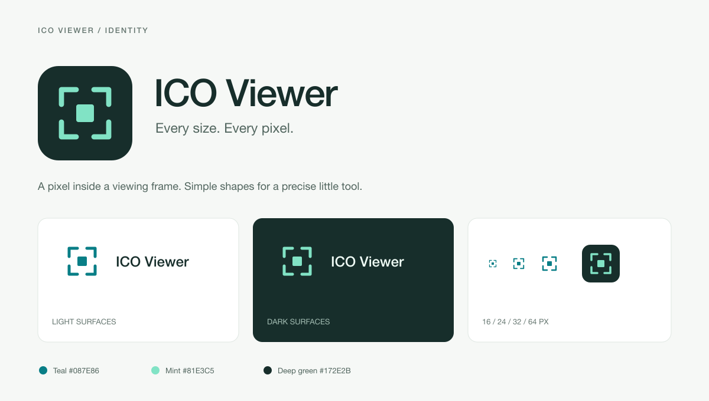

# ICO Viewer

**Every size. Every pixel.**

Inspect ICO icons and CUR cursors. Preview every size and export PNGs.

## License

The **ICO Viewer** extension name and logo are reserved and excluded from the project's [MIT License](LICENSE). No license to reuse the name or logo is granted here.

The logo includes the app tile, standalone marks, and their light, dark, and file-icon variants in `resources/branding/icon.svg`, `resources/branding/icon.png`, `resources/branding/mark.svg`, `resources/branding/mark-dark.svg`, `resources/icons/ico-light.svg`, and `resources/icons/ico-dark.svg`. The same exclusion applies to the logo as shown in the branding previews and generated copies. Other material, including this document's text and the CUR arrow icons, is MIT-licensed.

## Name

ICO Viewer is the preferred name: clear, short, and explicit about the app's main purpose. Always capitalize ICO; use “ICO Viewer” in UI, documentation, and extension listings. Mention CUR support in the description rather than lengthening the name.

Other directions to consider:

| Name | Direction |
| --- | --- |
| Icon Lens | A more distinctive name that emphasizes inspection. |
| ICO Scope | Compact and technical, with a clear ICO connection. |
| Icon Peek | Friendly and lightweight; suggests a quick preview. |

## Logo

A single pixel inside four viewing-frame corners. The pixel represents the image; the frame represents inspection. Flat shapes, one foreground color, and no lettering keep it readable at small sizes.



| Asset | Use |
| --- | --- |
| [icon.svg](resources/branding/icon.svg) | Editable app tile and browser favicon. |
| [icon.png](resources/branding/icon.png) | 256 × 256 extension icon, rendered from the SVG. |
| [mark.svg](resources/branding/mark.svg) | Transparent mark on light surfaces. |
| [mark-dark.svg](resources/branding/mark-dark.svg) | Transparent mark on dark surfaces. |
| [ICO file icons](resources/icons/) | Optically adjusted 16 px marks for VS Code. |
| [preview.svg](resources/branding/preview.svg) | Editable presentation of the identity. |

Use teal `#087E86` on light surfaces, mint `#81E3C5` on dark surfaces, and deep green `#172E2B` for the app tile. Leave at least one center-pixel width of space around the standalone mark. Keep the mark at 16 px or larger. Use the small file-icon variant at 16 px rather than shrinking the app tile.

The browser toolbar pairs the mark with the system-font wordmark. VS Code keeps its theme colors and header-free editor layout.

Regenerate the PNGs with [librsvg](https://gitlab.gnome.org/GNOME/librsvg)'s `rsvg-convert`:

```sh
rsvg-convert resources/branding/icon.svg -o resources/branding/icon.png
rsvg-convert resources/branding/preview.svg -o resources/branding/preview.png
```

## Extension identifiers

The VS Code extension ID is `jcoc611.icoviewer`. Existing `icoAtlas.*` editor, tree, and command identifiers and `ico-atlas-*` language IDs remain stable so saved editor associations and bindings keep working.
